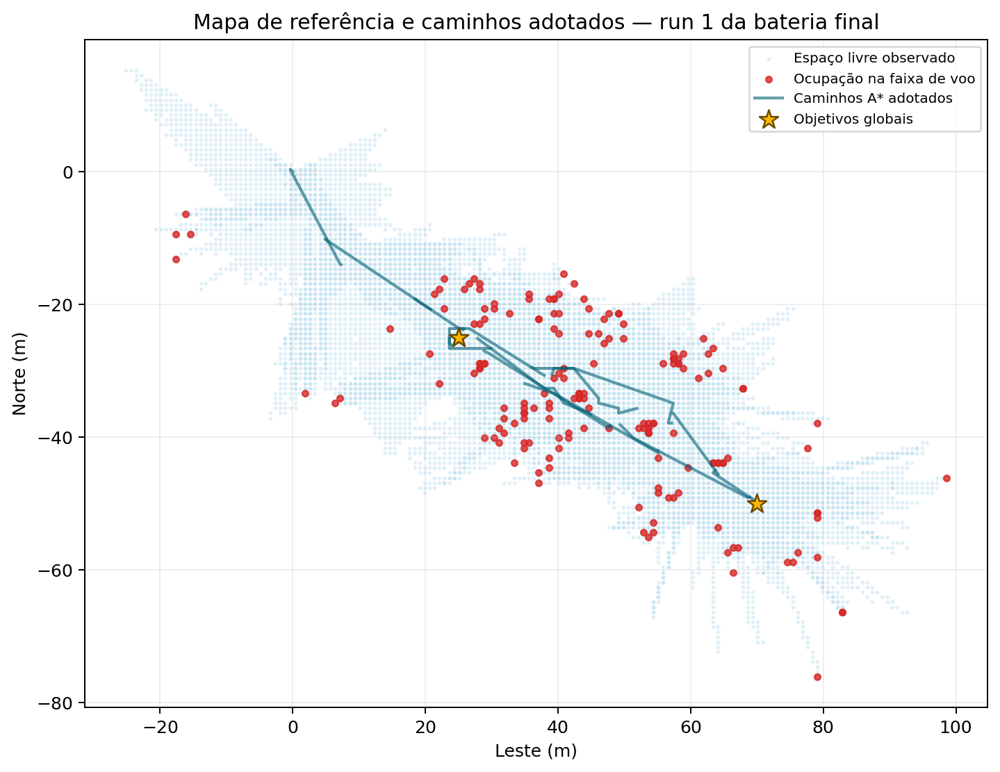

# Antes da Arquitetura

**Avaliação Experimental de Sinais Monoculares e Inerciais para Percepção de Proximidade em VANTs**

Este TCC avalia sinais visuais e inerciais para estimar proximidade e investiga o uso de profundidade monocular no mapeamento 3D e no planejamento A*. A [versão de entrega](https://github.com/Gabriel-Panza/TCC_Drone/releases/tag/tcc-entrega-v1.0) reúne o código congelado e o pacote de reprodução.

## Qual experimento rodar?

| Objetivo | Onde rodar | Roteiro |
|---|---|---|
| Voar no Baylands com profundidade de referência do Gazebo | Ubuntu/WSL com PX4, Gazebo e ROS 2 | [Run ground truth](#1-run-ground-truth) |
| Testar a mesma rota usando profundidade monocular | Ubuntu/WSL com PX4, Gazebo e ROS 2 | [Run monocular na mesma rota](#2-run-monocular-na-mesma-rota) |
| Ver a profundidade monocular no mapa | Mesmo simulador, com o drone parado | [Mapa monocular com o drone parado](#mapa-monocular-com-o-drone-parado) |
| Reproduzir os resultados finais da v21 | Terminal Linux com Python, sem simulador | [Replay monocular offline](#3-replay-monocular-offline) |
| Examinar as métricas dos sinais visuais e inerciais | Jupyter, na raiz do projeto | [Análise tabular](#4-análise-tabular) |

## Preparar a simulação

Use **dois terminais Ubuntu/WSL**. O ambiente de referência tem Ubuntu 22.04, Python 3.10, ROS 2 Humble, Gazebo Harmonic 8.10.0 e PX4 no commit `e2708705a8ca625854f1129fd9dde2ae8ae16d59`. Os comandos assumem o projeto em `~/TCC_Drone`, o PX4 em `~/PX4-Autopilot` e o workspace ROS 2 do projeto já compilado. As dependências Python do simulador e da análise estão em [requirements.txt](requirements.txt).

Em uma instalação nova, prepare primeiro o sensor de referência do Gazebo, as interfaces ROS e, para o monocular, o ONNX v21. [Guia de instalação e registro dos voos ao vivo](docs/reproducao_ao_vivo.md)

**Terminal 1 · Agente e pontes de imagem.** Pode rodar de qualquer pasta. Mantenha esse terminal aberto e reutilize os três processos entre as execuções.

```bash
source /opt/ros/humble/setup.bash

MicroXRCEAgent udp4 -p 8888 &
ros2 run ros_gz_bridge parameter_bridge \
  '/world/baylands/model/x500_mono_cam_0/link/camera_link/sensor/camera/image@sensor_msgs/msg/Image[gz.msgs.Image' &
ros2 run ros_gz_bridge parameter_bridge \
  '/sim_depth_ground_truth@sensor_msgs/msg/Image[gz.msgs.Image' &
wait
```

**Terminal 2 · Antes de rodar.** Encerre o PX4/Gazebo manual e qualquer estimador monocular iniciado à parte. Mantenha o Terminal 1 aberto. Em ambos os modos, o executor carrega o ROS 2, inicia o `x500_mono_cam` no Baylands e encerra os processos que iniciou. As janelas do Gazebo e do mapa exigem uma sessão gráfica ativa no WSL.

## Rota publicada da bateria espacial

Execute um modo por vez no **Terminal 2**. Ambos usam PX4/Gazebo no Baylands e os três objetivos relativos publicados na monografia, em metros NED: `(-25, 25, -1.5)`, `(-50, 70, -1.5)` e `(-25, 25, -1.5)`. O alvo da decolagem inicial é 1,6 m e os três objetivos de navegação ficam a 1,5 m de altura. [Metodologia da monografia](Parte_Escrita/Monografia_TCC/elementos-textuais/capitulo4.tex)

### 1. Run ground truth

```bash
cd ~/TCC_Drone
env -u HEADLESS PROJECT_DIR="$PWD" PX4_DIR="$HOME/PX4-Autopilot" \
  SPATIAL_WAYPOINTS_RELATIVE_M='[-25.0,25.0,-1.5,-50.0,70.0,-1.5,-25.0,25.0,-1.5]' \
  MISSION_TIMEOUT_S=270 BATTERY_CONTINUE_SAFE_ABORTS=0 \
  ./scripts/run_spatial_battery.sh ground_truth_debug 1
```

Troque `1` por `10` para uma bateria com dez missões na rota publicada.

### 2. Run monocular na mesma rota

```bash
cd ~/TCC_Drone
bash scripts/run_monocular_v21_route.sh
```

Para repetir a mesma configuração até a primeira missão completa ou até cinco tentativas, use `bash scripts/run_monocular_v21_route.sh 5`. Cada tentativa tem limite operacional de 600 s, com opção de ajuste por `MISSION_TIMEOUT_S`. O roteiro encerra no primeiro `completed` e repete apenas falhas registradas da missão. Erros de inicialização ou de limpeza interrompem a sequência.

O executor usa a **v21 por padrão**, com o mesmo ONNX e perfil de profundidade do replay final. O perfil SITL usa amostragem 5 e bordas 2 a 640 × 480, margem de espaço livre de 3 m mais 12% da distância limitada a 6 m, incerteza de ocupação de 0,75 m, duas observações para marcar espaço livre ou ocupado, revisão de obstáculos após três observações separadas por 0,75 m e busca de saída inicial reta e curva. O mapa de referência pode vetar trajetos.

Em SITL, o estimador infere sobre novas imagens do Gazebo e usa seis threads de CPU. O guardião atualiza seu mapa enquanto aguarda a inferência. Se vetar o plano principal, o executor pode testar outros subobjetivos gerados pelo planejador monocular. Os três objetivos globais são os mesmos em todas as tentativas.

A recepção do RGB guarda o quadro e sua pose enquanto o mapa é integrado em outro callback. A profundidade monocular pode chegar até 1,30 s depois do seu quadro de origem. Cada previsão entra uma vez e requer o RGB e a pose correspondentes. O limite de 0,60 s do mapa de referência continua valendo.

Enquanto o mapa está ocupado, a v21 pode continuar no waypoint atual por até 2 s desde a última validação, se a pose estiver a até 0,35 m do segmento validado. O controlador freia se essas condições expirarem e revalida o caminho ao receber uma revisão do mapa. O resumo do dataset registra quantos ciclos mantiveram o waypoint ou pediram frenagem durante a espera.

O heartbeat Offboard da v21 é enviado a 25 Hz em uma thread própria. Se o comando de posição ficar mais de 0,25 s sem atualização, o heartbeat continua enviando um comando de espera. O resumo do dataset registra a contagem de envios e o maior intervalo entre eles no controlador.

Se a referência vetar o plano principal por espaço desconhecido e a busca de alternativas falhar, o executor pode seguir um trecho livre nos dois mapas. O trecho termina com um recuo de 2,5 m ao longo do caminho. O drone para nesse ponto e aguarda a integração de uma imagem mais recente que a chegada antes de replanejar para o mesmo objetivo. Procure `A*: v21_validated_prefix` no `controller.log` para identificar quando o executor adotou esse recurso.

Se o comprimento impedir a adoção de um plano local, a v21 pode usar um trecho de 0,50 m até o limite normal de 1,50 m. O trecho precisa aproximar o drone do objetivo em mais de 0,20 m e estar completamente livre nos dois mapas. Ao chegar, o drone para para observar antes de replanejar. Procure `A*: v21_short_observation` no `controller.log`.

Durante a execução, um veto em um segmento adiante pode encurtar o caminho ativo. O drone segue apenas o trecho confirmado nos dois mapas, para com margem de 2,5 m antes do veto e aguarda uma nova observação. Um veto no segmento que está sendo voado ainda aciona a frenagem. Procure `A* trecho ativo mantido` no `controller.log`.

Os **70,59%** do artigo medem pedidos de planejamento no replay de quadros gravados. A reprodução exata dessa métrica está no [replay monocular offline](#3-replay-monocular-offline). A bateria de qualificação exige relatórios aprovados de profundidade e mapeamento para o mesmo SHA-256 do ONNX. [Perfil SITL](config/spatial_monocular_v21.yaml) · [Configuração do replay](config/final_monocular_replay.json)

O mapa NED projeta os voxels ocupados em uma faixa de ±1,5 m ao redor do drone. Vermelho indica a camada atual do drone e cinza indica outras alturas. O controlador verifica os segmentos do caminho em 3D. Na v21 ao vivo, cada previsão usa o RGB de origem e a pose associada ao recebimento daquele quadro. A sincronização reduz deslocamentos artificiais dos obstáculos enquanto o drone anda ou gira. [Visualização NED](spatial_mapping/visualization.py) · [Controlador](drone_controller.py)

Na rota ao vivo da v21, os mapas só marcam ocupação em uma faixa de ±0,10 m em torno da altitude comandada de 1,5 m. A pose e a atitude do quadro continuam orientando a projeção da câmera em NED. A incerteza de ocupação termina na borda dessa faixa. Esse ajuste é da execução ao vivo. O replay publicado conserva o perfil original.

Na v21 ao vivo, uma detecção pendente bloqueia a própria célula. Obstáculos confirmados têm margem horizontal de 1,00 m no monocular e 1,25 m no mapa de referência. O planejamento e a execução verificam o caminho com a mesma regra.

Na janela da v21, o tempo no topo indica há quanto tempo terminou a última integração que a janela está mostrando. A projeção acompanha a pose atual mesmo entre integrações. [Visualização NED](spatial_mapping/visualization.py)

### Onde conferir as runs

Abra `logs/spatial_battery/<data>_<modo>/summary.tsv`. Uma missão completa tem `outcome=completed`. A coluna `dataset` aponta para a pasta com `spatial_map_3d.html`, quando gerado. Dentro de `run_01/` ficam `controller.log`, `px4_gazebo.log` e, no monocular, `monocular.log`.

Se o executor indicar processos residuais, encerre o simulador manual no terminal de origem. Se ainda restarem processos do PX4 ou Gazebo, rode `./scripts/cleanup_spatial_sim.sh` na raiz do projeto. Se um estimador manual ficou em segundo plano, encerre-o no terminal em que foi iniciado para evitar sobrecarga durante a bateria.

### Mapa monocular com o drone parado

Mantenha o agente e as pontes no Terminal 1. No **Terminal 2**, inicie o simulador manualmente com a bateria encerrada:

```bash
cd ~/PX4-Autopilot
env -u HEADLESS PX4_GZ_WORLD=baylands make px4_sitl gz_x500_mono_cam
```

**Terminal 3 · Estimador e mapa.** Quando o Baylands carregar, rode o bloco na raiz do projeto. Ele usa o mesmo arquivo ONNX v21 da bateria e o ambiente em `models/runtime_env`.

```bash
cd ~/TCC_Drone
source /opt/ros/humble/setup.bash
source ws_ros2/install/setup.bash

(
  PYTHONNOUSERSITE=1 models/runtime_env/bin/python monocular_depth_node.py \
    --ros-args --params-file config/monocular_depth_v21.yaml &
  estimador_pid=$!
  trap 'kill -TERM "$estimador_pid" 2>/dev/null || true; wait "$estimador_pid" 2>/dev/null || true' EXIT

  PYTHONNOUSERSITE=1 python3 main.py \
    --ros-args --params-file config/spatial_monocular_v21.yaml \
    -p spatial_execute_path:=false -p monocular_depth_max_age_s:=4.0
)
```

A tolerância de 4 s vale apenas para visualizar o mapa com o veículo parado. O estimador publica `/monocular_depth` e o controlador mostra a projeção superior. Encerre o mapa com `Ctrl+C` no Terminal 3. Para gerar o HTML a partir de um ensaio manual salvo, passe o diretório da execução em `datasets/spatial_mapping/` ao [analisador espacial](estudos_e_analises/analisar_mapeamento_espacial.py).

## 3. Replay monocular offline

Rode em **um terminal Linux**, na raiz do projeto. Use o [código da versão de entrega](https://github.com/Gabriel-Panza/TCC_Drone/releases/tag/tcc-entrega-v1.0) e salve o [pacote de reprodução](https://github.com/Gabriel-Panza/TCC_Drone/releases/download/tcc-entrega-v1.0/monocular_final_inputs.tar.gz) como `downloads/monocular_final_inputs.tar.gz` dentro do repositório. Na máquina do laboratório, o pacote já existe em `logs/monocular_final_inputs.tar.gz`. Nesse caso, use esse caminho em `--bundle`.

Prepare o ambiente Python uma vez:

```bash
cd ~/TCC_Drone
python3.10 -m venv .venv-repro
source .venv-repro/bin/activate
python -m pip install -r requirements-reproducao.txt
```

No mesmo terminal, execute o replay com um diretório de saída novo:

```bash
python scripts/replay_final_monocular.py \
  --bundle downloads/monocular_final_inputs.tar.gz \
  --output logs/minha_reproducao
```

O replay usa as predições salvas da v21 e repete o mapeamento e o planejamento em 77 quadros. O resultado esperado é **12 de 17 pedidos executáveis**, **4 de 401 voxels falsamente livres** e **zero colisões discretas nos 12 caminhos**. A checagem de caminho seguro no mapa de referência aprovou **5 dos 17 pedidos**. Os 70,59% correspondem a pedidos de planejamento com caminho executável em sequências gravadas. Veja `validation.json` e `replay.log` no diretório de saída.

Para exibir o replay no **Gazebo e no mapa NED** na máquina do laboratório, rode no Ubuntu/WSL:

```bash
cd ~/TCC_Drone
/usr/bin/python3 scripts/replay_v21_visual.py
```

O script usa o replay salvo em `logs/reproducao_portavel_final_20261031`. Quando as janelas abrirem, enquadre `x500_replay_v21` no Gazebo e pressione **Espaço** com o mapa NED em foco. As poses vieram de uma execução com ground truth. O mapa e os caminhos exibidos vêm do replay monocular v21. O Gazebo interpola as poses gravadas para a exibição, sem iniciar PX4.

Para regenerar apenas as figuras e o painel publicados, use `python scripts/reproduce_final_results.py` no mesmo ambiente. Essa opção usa os [resultados versionados](datasets/resultados_finais_monocular/results.json) e dispensa o pacote de replay.

## 4. Análise tabular

Abra o [notebook do estudo](estudos_e_analises/estudo_das_metricas.ipynb) no Jupyter, com o projeto aberto em `~/TCC_Drone` e um kernel com as dependências de [requirements.txt](requirements.txt). Comece pela seção final independente. As células históricas dependem dos dados originais de coleta, que não estão integralmente no repositório. Para novas coletas com o controlador reativo, consulte o [roteiro do pipeline legado](docs/execucao_pipeline_espacial.md#pipeline-legado-reativo).

## Resultados da entrega

| Eixo | Resultado |
|---|---|
| Sinais tabulares | 40 execuções e 1.234 intervalos válidos. Ganhos modestos com mais dados, estabilidade entre sementes e melhor consistência no grupo de IMU e atitude. |
| Ground truth ao vivo | 10/10 missões completas na bateria de referência, 30 objetivos, 147/156 planos e nenhum caminho inseguro adotado. |
| Monocular v21 ao vivo | Uma missão completa registrada no Baylands, com os três objetivos e pouso, em 23/11/2026. A profundidade de referência atuou como veto. [Registro da execução](docs/reproducao_ao_vivo.md#monocular-v21) |
| Monocular v21 em replay offline | 12 de 17 pedidos de planejamento executáveis (70,59%), cinco aprovados na checagem estrita da referência e 1,00% de falso espaço livre. |



## Código e documentação

O [controlador ROS 2](drone_controller.py) integra pose e profundidade, e o [módulo espacial](spatial_mapping/) atualiza a grade 3D e calcula os caminhos A*. O planejador fornece pontos de posição em NED e o PX4 executa o controle de baixo nível. O [estimador monocular](monocular_depth_node.py) publica profundidade métrica a partir das imagens RGB.

- [Execução e diagnóstico do pipeline espacial](docs/execucao_pipeline_espacial.md)
- [Metodologia e critérios de validação 3D](docs/validacao_espacial_3d.md)
- [Monografia](Parte_Escrita/Monografia_TCC/) e [roteiro de apresentação](docs/roteiro_apresentacao_espacial.md)
- [Licença](LICENSE)
